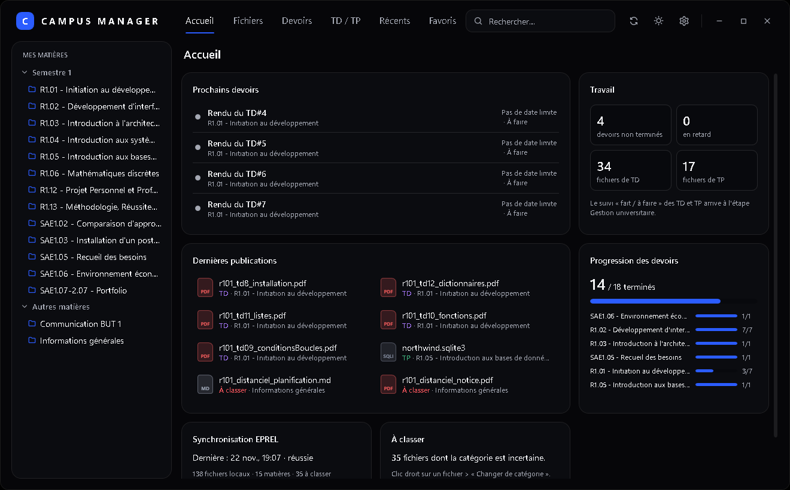
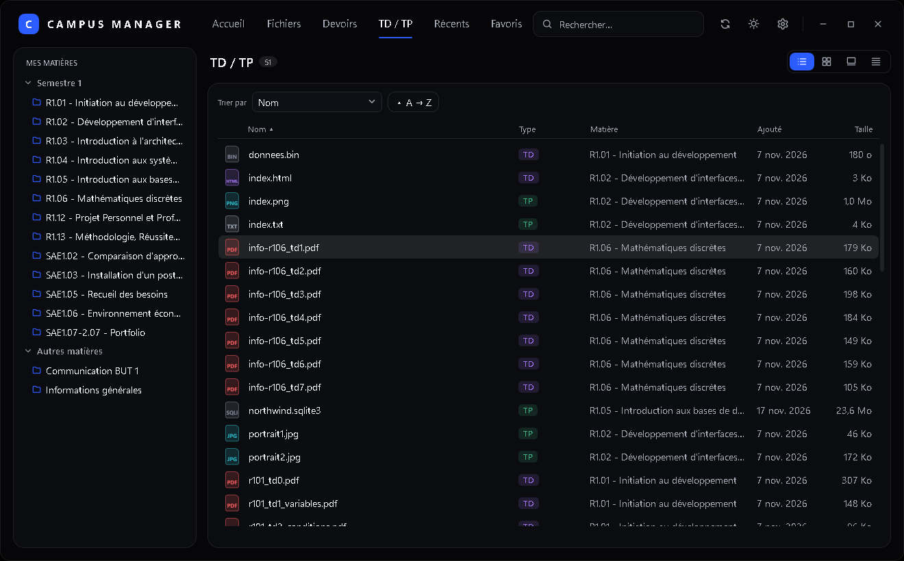
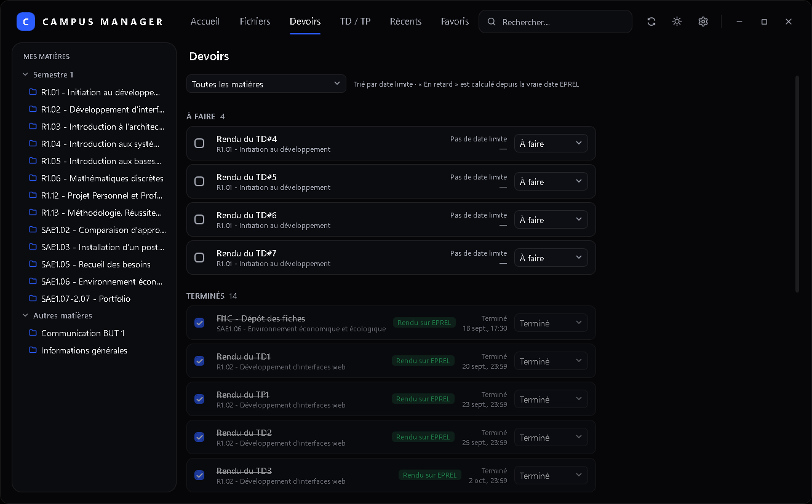
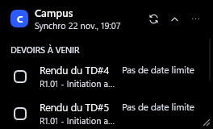

# Campus Manager

**Application Windows de gestion des cours universitaires**, qui synchronise la plateforme Moodle de mon université (EPREL, UPEC) puis fonctionne entièrement hors ligne.

Les fichiers de cours sont réellement téléchargés et classés automatiquement sur le disque, les devoirs sont suivis avec leurs vraies échéances, et un widget reste affiché sur le bureau Windows.

**[⬇ Télécharger l'installateur Windows](https://github.com/obvSoul/campus-manager/releases/latest)** (Windows 10/11 64 bits ; SmartScreen peut avertir car l'installateur n'est pas signé : « Informations complémentaires » puis « Exécuter quand même »).

   



| Explorateur de fichiers | Devoirs | Widget de bureau |
|---|---|---|
|  |  |  |

## Pourquoi

Sur Moodle, les documents sont dispersés entre des dizaines de sections, les dates limites changent (prolongations), et rien n'est accessible sans connexion. Campus Manager traite Moodle comme une simple **source de synchronisation** : une fois les cours récupérés, tout est local, rangé et consultable sans Internet.

## Fonctionnalités

- **Synchronisation Moodle** : connexion unique via le SSO de l'université (CAS), jeton chiffré par Windows (DPAPI), aucun mot de passe stocké.
- **Bibliothèque physique** : fichiers rangés dans `Documents\Campus Manager\Semestre\Matière\Catégorie`, utilisables avec n'importe quel logiciel.
- **Classement automatique** (Cours, TD, TP, Corrections, Projets…) par un système de règles pondérées avec score de confiance ; les cas douteux vont dans « À classer ».
- **Devoirs** : échéances réelles (prolongations comprises), statut « rendu » importé, devoirs des années précédentes séparés.
- **Explorateur** : 4 vues, tri, recherche globale, aperçu PDF (moteur PDF de Windows), images et texte, glisser-déposer depuis et vers l'Explorateur Windows.
- **Widget de bureau** : transparent, fixé au niveau du bureau (sous les fenêtres), masqué automatiquement pendant un jeu en plein écran.
- **Arrière-plan** : démarrage avec Windows, raccourcis clavier globaux, l'appli continue quand la fenêtre est fermée.
- **Installateur** Windows (Inno Setup) sans droits administrateur.

## Léger

La version 0.2 est une réécriture en C# / WPF de la version Electron 0.1. Mesures sur la même machine et les mêmes données (mémoire privée, colonne « Mémoire » du Gestionnaire des tâches) :

| | Electron 0.1 | C# 0.2 |
|---|---|---|
| Widget seul (démarrage avec Windows) | 116 Mo | 40 Mo |
| Widget + fenêtre principale | 125 Mo | 50 Mo |
| Réouverture de la fenêtre | 0,34 s | 0,34 s |
| Lancement complet (disque en cache) | 0,43-0,67 s | 0,86-1,0 s |
| Installateur | 117 Mo | 53 Mo |

## Points techniques intéressants

- **Authentification SSO** : reproduction du flux de l'application Moodle officielle (`launch.php` → redirection `moodlemobile://token=…`), interception de la redirection dans un WebView2 créé seulement le temps de la connexion, et vérification de la signature MD5 renvoyée par le serveur.
- **Synchronisation sûre** : écriture atomique (`.part` puis renommage), empreinte SHA-256, aucun retéléchargement des fichiers inchangés. Un fichier modifié par l'utilisateur n'est **jamais écrasé** : la nouvelle version est enregistrée à côté. Un fichier déplacé dans l'Explorateur est retrouvé par taille et empreinte.
- **Widget « collé » au bureau** : P/Invoke Win32 : rattachement à la fenêtre du bureau (`Progman`), style fenêtre outil, `SetWindowPos(HWND_BOTTOM)`, clic à travers (`WS_EX_TRANSPARENT`), détection d'une application plein écran avec `GetForegroundWindow` / `GetMonitorInfoW`.
- **Mémoire** : ramasse-miettes station sans thread d'arrière-plan, `ConserveMemory`, fenêtre principale réellement fermée (pas cachée), aperçus libérés dès qu'on change de fichier, compactage après une synchronisation.
- **Échéances fiables** : l'API des devoirs ne donne que la date initiale ; la vraie date (avec prolongation) est récupérée dans la chronologie du calendrier Moodle puis rapprochée par identifiant de module.

## Architecture

```
src/
  CampusManager.Core/   logique sans interface (testée)
    Db/                 schéma SQLite et migrations
    Library/            fichiers sur disque : import, déplacement, conflits, réconciliation
    Classify/           classement automatique
    Sync/               client API Moodle, SSO, moteur de synchronisation
    Queries/            lectures pour l'interface et le widget
  CampusManager.App/    WPF : fenêtres, widget, Win32, jeton, démarrage Windows
tests/CampusManager.Tests/   xUnit (vrais fichiers sur disque, API Moodle simulée)
installer/              Inno Setup
```

Détails : [ARCHITECTURE.md](ARCHITECTURE.md).

**Stack** : C# 14 / .NET 10, WPF, CommunityToolkit.Mvvm, Microsoft.Data.Sqlite + Dapper, WebView2 (connexion seulement), Windows.Data.Pdf, xUnit, Inno Setup.

## Lancer le projet

Prérequis : Windows 10/11, SDK .NET 10.

```powershell
dotnet run --project src\CampusManager.App    # lance l'application
dotnet test                                    # 61 tests
installer\build.ps1 -Version 0.2.0             # crée l'installateur dans installer\Output
```

Options : `--hidden` (widget seul), `--page=assignments|work|settings|course/<id>…`. Variable `CAMPUS_DATA_DIR` : travailler sur une copie des données (le démarrage Windows réel n'est alors pas modifié).

La première synchronisation ouvre la page de connexion de l'université. L'application est conçue pour EPREL (UPEC) ; un autre Moodle qui autorise l'application mobile officielle peut être visé avec la variable d'environnement `EPREL_URL` (non testé).

## Feuille de route

Calendrier, synchronisation automatique avec notifications, choix du dossier racine.
